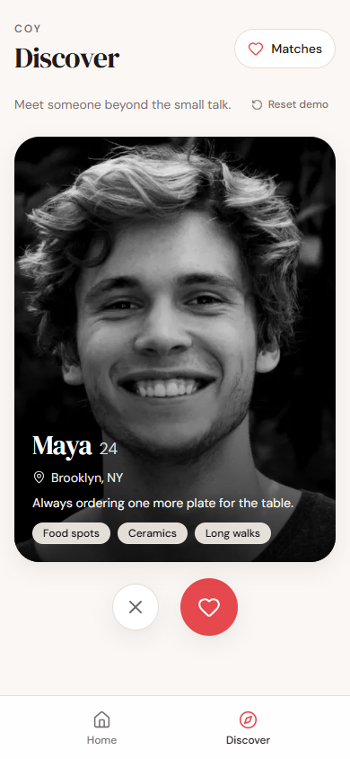
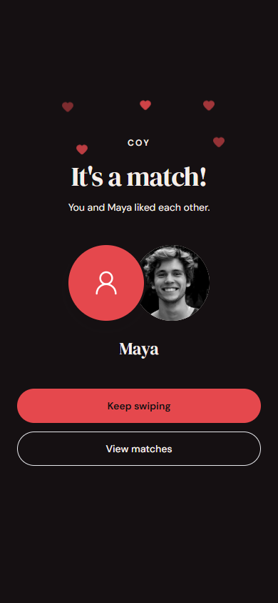
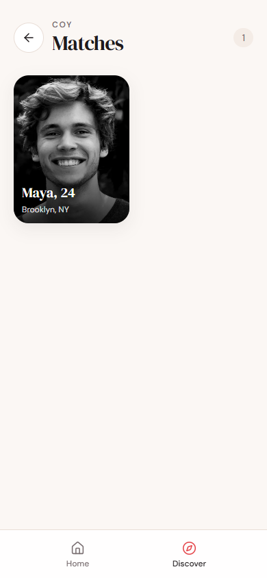
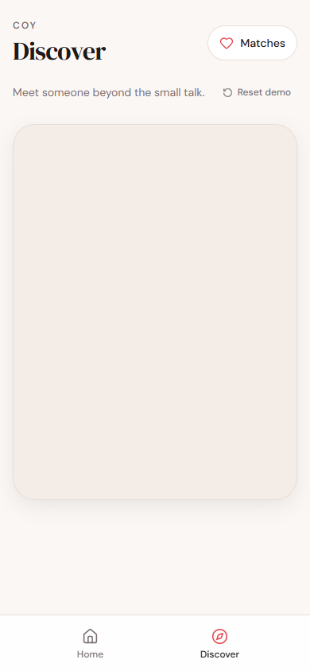
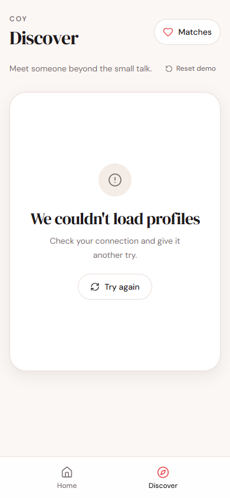
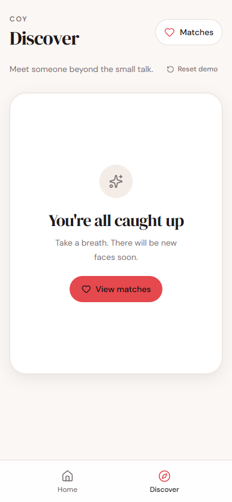

# Coy Discover

A mobile-first, swipe-based Discover experience for Coy, built around a simple
promise: nobody learns who liked them unless the feeling is mutual. The app
uses a single demo account (`me`), persists swipes and matches in PostgreSQL,
and keeps every non-mutual like private.

## Screens

The screenshots below are captured from the running app at a 390 × 844 viewport.

### Discover deck



### Mutual match



### Matches



### Loading, error, and empty states

| Loading                                                   | Error                                                  | All caught up                                               |
| --------------------------------------------------------- | ------------------------------------------------------ | ----------------------------------------------------------- |
|  |  |  |

## Run locally

Requires Node.js 22 or newer and a persistent PostgreSQL database.

```bash
npm install
npm run seed
npm run dev
```

Open [http://localhost:3000](http://localhost:3000). On the first API request,
the app creates the PostgreSQL schema and seeds it automatically. Configure
`DATABASE_URL` (or `POSTGRES_URL`) in your local `.env.local` before running
these commands and in the hosting provider's production environment. The app
deliberately has no SQLite or ephemeral-filesystem fallback.

Useful commands:

```bash
npm run reset       # clear demo swipes/matches and restore seeded actions
npm test            # run Vitest service and route-handler tests
npm run lint        # run ESLint
npm run build       # create a production build
npm run format      # format source and documentation with Prettier
```

The small **Reset demo** action is available in development only.

## Experience

- Drag right to like and left to pass; the card springs back when released
  before the commit threshold. The Like and Pass buttons and Left/Right arrow
  keys trigger the same flow.
- Swipe submissions optimistically advance the deck. A failed request restores
  the card and shows a retry-friendly toast.
- The next feed batch is fetched when three or fewer cards remain. IDs are
  deduplicated across batches.
- Matches are fetched again whenever the Matches view opens, so they persist
  across reloads. A successful mutual like opens the match moment immediately.
- Light and dark themes follow `prefers-color-scheme`; reduced-motion settings
  switch the larger transitions to fades.
- Text contrast was checked against WCAG AA: muted body copy on the warm light
  surface is at least 4.5:1, and dark text on the coral action surface is above
  4.5:1. Coral is reserved for icons and focus indicators where it is not used
  as small text.

## API reference

All endpoints return JSON. Profile payloads contain only public profile
fields: `id`, `name`, `age`, `photo_url`, `bio`, `city_or_college`, and
`interests`.

### `GET /api/feed?limit=10`

Returns up to ten profiles that `me` has not swiped on. `limit` is optional and
must be an integer from 1 to 10.

```json
{
  "profiles": [
    {
      "id": "p13",
      "name": "Aisha",
      "age": 25,
      "photo_url": "https://i.pravatar.cc/900?img=24",
      "bio": "Collecting tiny joys and good soup recipes.",
      "city_or_college": "Queens, NY",
      "interests": ["Cooking", "Gardening", "Comedy"]
    }
  ]
}
```

### `POST /api/swipe`

Request:

```json
{ "targetId": "p01", "direction": "like" }
```

Non-mutual likes and passes have the same response shape:

```json
{ "matched": false }
```

Only a mutual like includes a profile:

```json
{
  "matched": true,
  "profile": {
    "id": "p01",
    "name": "Maya",
    "age": 24,
    "photo_url": "https://i.pravatar.cc/900?img=12",
    "bio": "Always ordering one more plate for the table.",
    "city_or_college": "Brooklyn, NY",
    "interests": ["Food spots", "Ceramics", "Long walks"]
  }
}
```

Invalid JSON or fields return `400` with `{"error":"Invalid request"}`.
An unknown profile returns `404` with `{"error":"Profile not found"}`. Repeating
a swipe preserves the original choice and does not create another row.

### `GET /api/matches`

Returns mutual matches, newest first. Each public profile includes `matchedAt`.

```json
{
  "matches": [
    {
      "id": "p01",
      "name": "Maya",
      "age": 24,
      "photo_url": "https://i.pravatar.cc/900?img=12",
      "bio": "Always ordering one more plate for the table.",
      "city_or_college": "Brooklyn, NY",
      "interests": ["Food spots", "Ceramics", "Long walks"],
      "matchedAt": "2026-11-17 12:00:00"
    }
  ]
}
```

### `POST /api/reset` (development only)

Clears swipes and matches, then restores the deterministic seed state. Returns
`{"ok":true}` in development and `404` otherwise.

## Production data and privacy

The app uses PostgreSQL through `pg`, with a one-connection pool per warm
serverless instance. Schema initialization and idempotent seed insertion run
before API requests, so the 36 demo profiles are available when the persistent
database is first connected. Swipes and matches live in that same database and
survive function restarts and redeployments. Set the hosted database's
connection string as `DATABASE_URL` (or one of `POSTGRES_URL`,
`POSTGRES_PRISMA_URL`, or `POSTGRES_URL_NON_POOLING`) in Vercel. No database
secret belongs in source control.

- `profiles` contains no like state. Seeded incoming likes and passes are
  private rows in `swipes` with `target_id = 'me'`; the profile mapper selects
  and validates only public fields before any response is built.
- Feed selection excludes swipe targets for `me` and orders solely by
  profile ID. It never joins, sorts, or branches on incoming like state.
- The swipe service checks for a reciprocal like for either direction and
  returns the exact same `{ "matched": false }` payload for a pass and a
  non-mutual like. A profile is included only when a mutual match exists.
- The swipe row and any resulting match row are committed in one PostgreSQL
  transaction. The matches query also verifies both stored directions are
  likes, so seeded incoming actions alone never appear as matches.
- Error responses do not include database details or explain why a swipe did
  not match.

## Design decisions

- **PostgreSQL:** Vercel functions may run on ephemeral, read-only filesystems,
  so a local SQLite file is not a production persistence layer. PostgreSQL
  keeps seed profiles, swipes, and matches durable across instances and
  deployments. Tests use an isolated in-memory PostgreSQL-compatible database.
- **Transaction for a swipe:** the choice and possible match must never be
  observed in a partially written state.
- **Single-user assumption:** this assignment has no external auth; every
  user action uses the fixed ID `me`. Incoming likes remain internal seed
  data.
- **Stable ordering:** profile IDs keep feed order independent of hidden
  incoming actions and make feed behavior deterministic for the demo.

With more time, I would add real authentication and per-user authorization,
cursor pagination, undo-last-swipe, and rate limiting. I would also replace the
placeholder portrait service with a curated, consented image set.

## Stack

Next.js App Router with TypeScript, Route Handlers on the Node runtime,
Tailwind CSS, Framer Motion, Lucide, Zod, PostgreSQL via `pg`, and Vitest with
`pg-mem` for isolated service tests.
